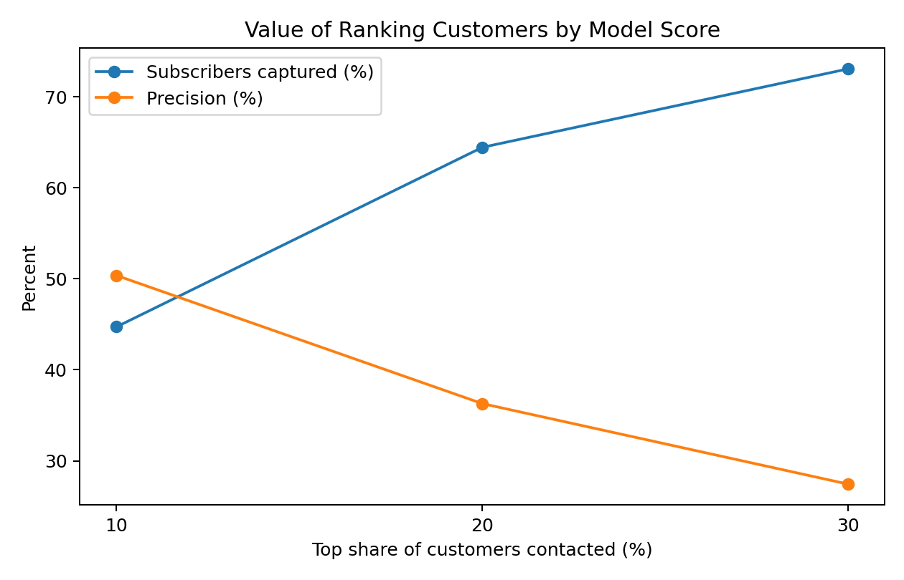
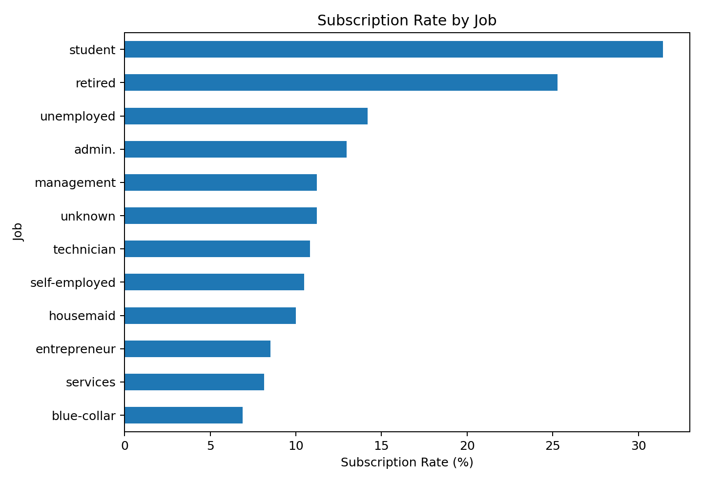
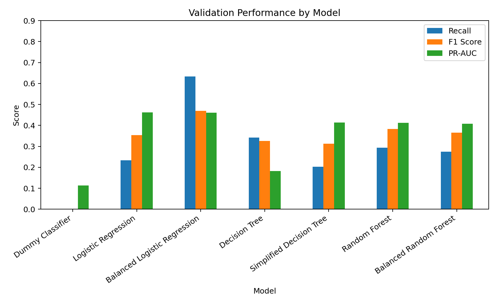
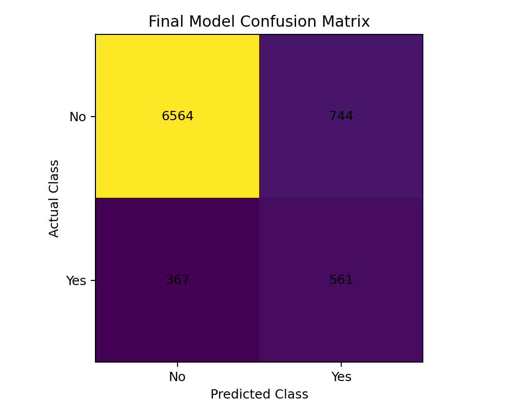
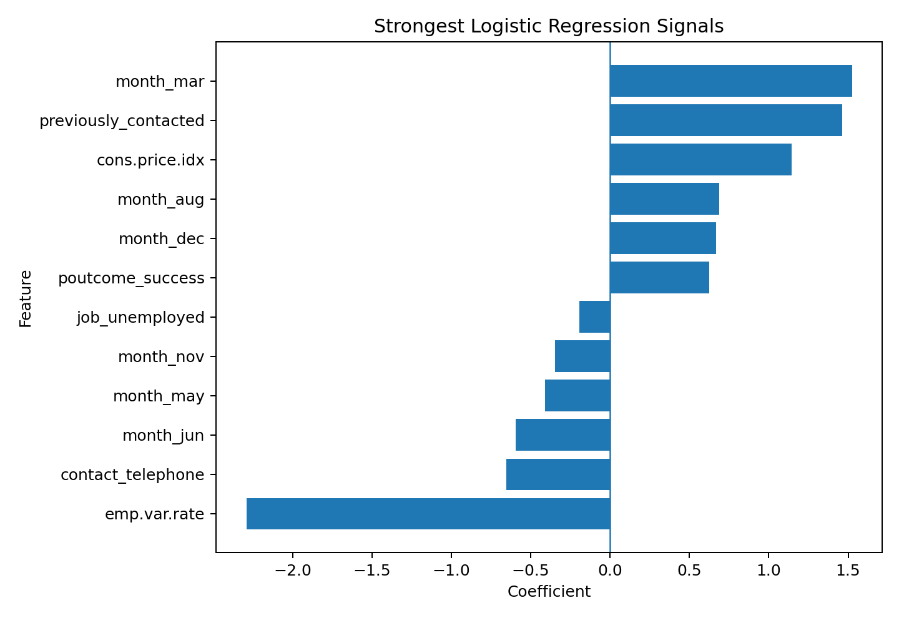

# Bank Marketing: Who Is More Likely to Subscribe?

A customer-targeting machine learning project using bank telemarketing data. I used exploratory analysis and classification models to understand which customers were more likely to subscribe to a term deposit, then tested whether model ranking could help a bank focus limited call capacity on better prospects.



## The question I wanted to answer

A bank can contact thousands of customers during a campaign, but only a small share may eventually subscribe. The question behind this project was simple:

> **Can the bank use information it already has before a call to rank customers by how likely they are to subscribe?**

The dataset contains customer information, campaign history, previous campaign outcomes, and economic indicators. I excluded call `duration` from the predictive model because the bank would not know that value before making the call.

## Dataset snapshot

- Raw observations: **41,188**
- Observations after removing 12 exact duplicates: **41,176**
- Target: `y` — whether the customer subscribed to a term deposit
- Subscription rate: **11.3%**
- Source: UCI Bank Marketing dataset, social/economic context version

See [`data/README.md`](data/README.md) for download instructions and the paper citation.

## What I found during EDA

A few patterns stood out:

- **Previous campaign history was very strong.** Customers previously contacted had a subscription rate of about **63.8%**, compared with **9.3%** for customers without previous contact.
- **A previous successful campaign mattered.** Customers with `poutcome = success` converted at about **65.1%**.
- **Repeated contact showed diminishing returns.** Subscription fell from about **13.0%** after one contact to **6.1%** for five or more contacts.
- **Cellular contact performed better in this dataset.** Cellular conversion was about **14.7%**, versus **5.2%** for telephone.
- **Students and retired customers had high conversion rates**, although those groups were smaller than the largest job categories.
- Some months had very high conversion rates, but those months also had much lower campaign volume. I treated month together with the wider economic context rather than as a simple rule.



## Modelling approach

I used a clean development / holdout workflow:

1. Split off **20% as a final holdout test set**.
2. Split the remaining 80% into training and validation sets.
3. Fit one-hot encoding and scaling from the training data only.
4. Compare candidate models on validation data.
5. Tune the Balanced Logistic Regression decision threshold on validation data.
6. Retrain the selected model on the full development set.
7. Evaluate the final model once on the holdout test set.

Models compared:

- Dummy Classifier
- Logistic Regression
- Balanced Logistic Regression
- Decision Tree
- Depth-limited Decision Tree
- Random Forest
- Balanced Random Forest

The target is heavily imbalanced, so I did not use accuracy as the main decision metric. I paid more attention to **recall, F1-score, ROC-AUC, and PR-AUC**.



## Final model

**Balanced Logistic Regression** gave the best fit for the business goal. I tuned the classification threshold on the validation set and selected **0.64** because it produced the best validation F1-score in the threshold search.

Final holdout performance:

| Metric | Score |
|---|---:|
| Accuracy | 0.865 |
| Precision | 0.430 |
| Recall | 0.605 |
| F1-score | 0.502 |
| ROC-AUC | 0.800 |
| PR-AUC | 0.447 |

The final confusion matrix was:

```text
[[6564  744]
 [367  561]]
```



The model found about **60.5% of actual subscribers**. Precision was about **43.0%**, so the model still generates false positives. I see the main value in **ranking customers**, rather than treating the output as a perfect yes/no answer.

## The result I find most useful

If the bank has a limited call budget, ranking customers becomes more practical than contacting everyone.

| Customers contacted | Precision | Subscribers captured | Lift vs random |
|---|---:|---:|---:|
| Top 10% | 50.4% | 44.7% | 4.47x |
| Top 20% | 36.3% | 64.4% | 3.22x |
| Top 30% | 27.4% | 73.1% | 2.44x |

The **top 10%** of customers ranked by the model contained about **45% of all subscribers** in the holdout test set and delivered about **4.5x lift** over random targeting.

For me, that is the strongest business result in the project. It shows how the model could help a marketing team focus on a smaller group with a much higher concentration of likely subscribers.

## What the model is using

Some model signals matched the EDA well. Previous campaign contact and a previous successful outcome pushed predictions toward subscription. March was also a strong positive signal. Telephone contact moved predictions in the opposite direction relative to cellular contact.

I treat the economic coefficients carefully because several economic variables move together over time. The coefficients are useful for understanding the fitted model, but they are not causal effects.



## Business takeaways

- Use **previous campaign history** when ranking customers for future campaigns.
- Watch **repeated calling**: customers contacted many times showed lower conversion in this dataset.
- Treat **cellular vs telephone** as a useful campaign signal, while checking whether the same pattern holds in newer data.
- Combine **campaign timing with economic conditions** instead of turning a single month into a targeting rule.
- Use the model mainly as a **ranking tool** when call capacity is limited.

## Limitations

- The campaigns were run between **2008 and 2010**, so the model should be retrained before use on modern customers.
- The data comes from one banking setting and may not generalize to other markets.
- `unknown` values remain as categories rather than being imputed.
- The positive class is small, so the model still misses subscribers and produces false positives.
- Economic variables are correlated, which makes individual Logistic Regression coefficients harder to interpret.
- The class-weighted model score is useful for ranking, but I would not treat a score of 0.64 as a perfectly calibrated real-world probability.

## Repository structure

```text
bank-marketing-portfolio/
├── README.md
├── requirements.txt
├── .gitignore
├── GITHUB_UPLOAD_GUIDE.md
├── PORTFOLIO_SUMMARY.md
├── data/
│   └── README.md
├── images/
│   ├── final_confusion_matrix.png
│   ├── model_coefficients.png
│   ├── model_comparison.png
│   ├── ranking_value.png
│   ├── subscription_rate_by_campaign_contacts.png
│   ├── subscription_rate_by_job.png
│   └── target_distribution.png
├── notebooks/
│   └── bank_marketing_analysis.ipynb
└── results/
    ├── final_model_metrics.csv
    ├── reference_categories.csv
    ├── threshold_search.csv
    ├── top_customer_ranking.csv
    └── validation_model_comparison.csv
```

## Run the project locally

```bash
git clone <your-repository-url>
cd bank-marketing-portfolio
python -m venv .venv
```

On Windows PowerShell:

```powershell
.\.venv\Scripts\Activate.ps1
pip install -r requirements.txt
jupyter notebook
```

Download `bank-additional-full.csv` and place it inside the `data/` folder, then open `notebooks/bank_marketing_analysis.ipynb`.

## Tools

Python · Pandas · NumPy · Matplotlib · scikit-learn · Jupyter Notebook

## Dataset citation

S. Moro, P. Cortez and P. Rita. A Data-Driven Approach to Predict the Success of Bank Telemarketing. Decision Support Systems, 62 (2014), 22–31. https://doi.org/10.1016/j.dss.2014.03.001
